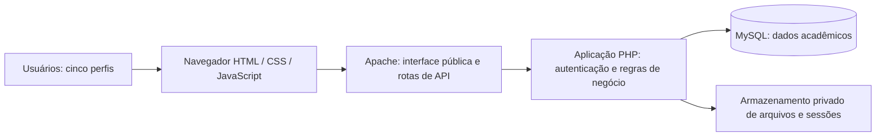

# Arquitetura do PRIMEWay School

## Visão geral

O PRIMEWay School é uma aplicação web com separação entre a interface entregue ao navegador, as APIs PHP, a camada de persistência e a infraestrutura de execução.



## Componentes identificados

| Camada | Tecnologias e responsabilidades |
|---|---|
| Interface web | HTML, CSS e JavaScript para páginas, menus e interações |
| API / regras de negócio | PHP com endpoints por área funcional e por perfil de usuário |
| Autenticação e autorização | Sessões e validação de acesso às rotas e funcionalidades |
| Persistência | MySQL, consultas SQL e arquivos de estrutura/migração |
| Armazenamento | Área privada para sessões e arquivos da aplicação |
| Execução | PHP 8.3 e Apache na imagem utilizada no ambiente Railway |

## Organização do código de origem

```text
primeway-school/
├── public/                  # Páginas, CSS, JS e pontos públicos da API
├── private/app/             # Regras PHP, configuração e estrutura de dados
│   ├── api/
│   ├── config/
│   └── database/
├── docker/                  # Arquivos de execução do ambiente atual
├── Dockerfile
└── .github/workflows/       # Rotinas automatizadas do projeto
```

Na aplicação publicada, as páginas estáticas vêm de `public/` e o código da aplicação privada é colocado fora do diretório público do Apache. Os endpoints em `public/api/` encaminham as solicitações para a lógica privada.

## Integrações

- O navegador se comunica com as APIs de acordo com a função e o perfil do usuário.
- O PHP utiliza conexão PDO com MySQL.
- O módulo de Saída Segura recebe coordenadas do navegador, calcula a distância até um ponto de referência e atualiza o fluxo no banco.
- Chat, calendário, atividades e notificações usam rotas específicas do sistema.

## Limites deste documento

A presença de arquivos de CI e de controles de autenticação indica uma estrutura de engenharia e validação, mas **não comprova ausência de vulnerabilidades**. A publicação do código exige revisão separada de configuração, credenciais, dependências, histórico do Git e direitos de distribuição.
