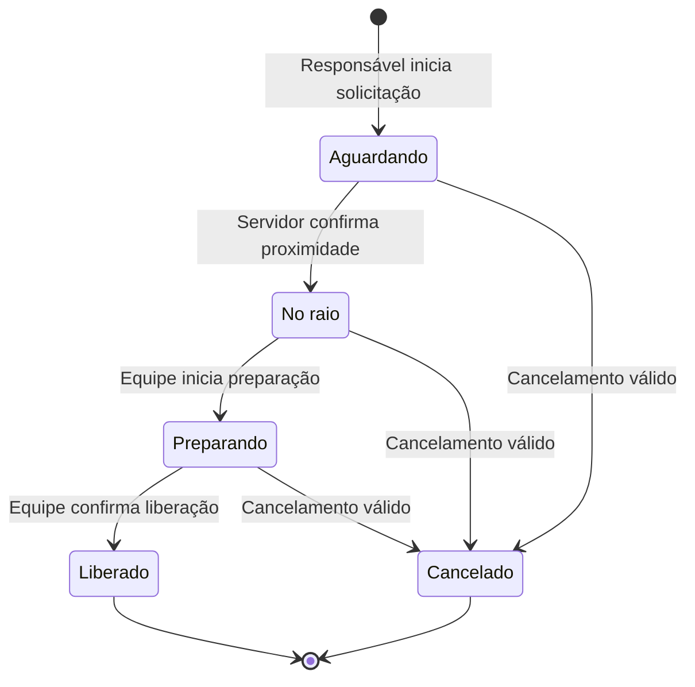

# Saída Segura com GPS

## Problema que a funcionalidade procura resolver

A retirada de alunos pode envolver comunicação tardia, espera na portaria e dificuldade de coordenação entre responsáveis e Secretaria. A proposta do PRIMEWay School é reunir a solicitação e a confirmação de proximidade em um fluxo rastreável.

## Funcionamento confirmado no código analisado

| Etapa | Quem atua | O que acontece no sistema |
|---|---|---|
| 1. Solicitação | Responsável autorizado | Inicia a solicitação do aluno vinculado; estado `Aguardando` |
| 2. GPS | Navegador do responsável | Com permissão, fornece a localização para cálculo da distância |
| 3. Proximidade | API PHP | Ao detectar a entrada no raio, altera para `No raio` e notifica a equipe |
| 4. Preparação | Secretaria ou Administração | Altera `No raio` para `Preparando` |
| 5. Liberação | Secretaria ou Administração | Confirma `Preparando` para `Liberado` |

As transições `No raio → Preparando → Liberado` são executadas por usuários da equipe autorizados. A chegada ao raio **não** conclui automaticamente a liberação.

## Como o GPS é utilizado

- A interface do responsável utiliza a API de geolocalização do navegador, com consentimento do usuário.
- O servidor PHP recebe latitude e longitude, valida o formato e calcula a distância usando a fórmula de Haversine.
- O ponto de referência e o raio são definidos por configuração.
- O endpoint de atualização de localização calcula a proximidade sem persistir as coordenadas recebidas no MySQL.
- O histórico registra as transições da solicitação e a equipe recebe uma notificação ao ser detectada a entrada no raio.

**Cenário de demonstração:** o código possui um ponto de referência **fictício**, explicitamente identificado para o TCC, com raio de exemplo de **300 metros**. Essa configuração não comprova a adequação para uso real em uma instituição.

## Controles identificados

O início da solicitação exige autenticação no perfil de responsável, proteção CSRF e vínculo de retirada autorizado com o aluno. A alteração do estado pela equipe exige perfil de Secretaria ou Administração e respeita as transições permitidas.

Esses controles não substituem verificações presenciais de identidade, autorização, proteção contra falsificação de localização, revisão de acessibilidade e validações operacionais exigidas em uma implantação real.

## Diferença entre o conceito idealizado e a implementação atual

**Visão desejada:** o responsável avisa com antecedência; a Secretaria pode começar a preparação antes de sua chegada; o GPS sinaliza a proximidade; a equipe confirma a liberação.

**Implementação examinada:** a solicitação pode ser iniciada antes, mas a transição do estado para `Preparando` só é permitida **após** o responsável entrar no raio. A última etapa, `Liberado`, continua manual e sujeita a autorização.

**Melhoria futura:** estudar um estado de *pré-preparação* anterior à proximidade, sem permitir liberação antes das verificações necessárias. Essa mudança dependerá de atualização do código, testes e regras claras para a Secretaria.

## Arquivos de referência no repositório privado

- `private/app/api/responsavel/saida_segura/iniciar.php`
- `private/app/api/responsavel/saida_segura/atualizar_localizacao.php`
- `private/app/api/secretaria/saida_segura/alterar_status.php`
- `private/app/api/responsavel/saida_segura/_config.php`
- `private/app/js/responsavel_saida_segura.js`
- `private/app/js/secretaria_saida_segura.js`

Este documento descreve o comportamento observado na versão analisada; não é uma certificação de segurança para escolas.
